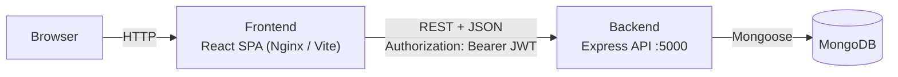
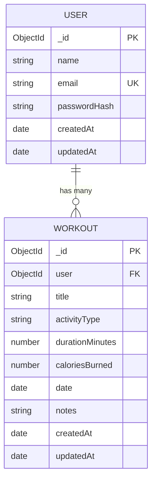

# FitTrack Web Dashboard

A full-stack fitness tracking web application: users register their workouts, follow their physical activity and review their history and statistics on a dashboard.

- **Repository:** https://github.com/mmyro/fittrack-web-dashboard
- **Live application:** _to be added after deployment_
- **GitHub Project board:** _link to be added_
- **Documentation (Google Docs):** _link to be added_

---

## Table of contents

1. [Project Title](#1-project-title)
2. [Project Overview](#2-project-overview)
3. [Target Users](#3-target-users)
4. [Core Functionalities](#4-core-functionalities)
5. [Non-Functional Requirements](#5-non-functional-requirements)
6. [Technology Stack](#6-technology-stack)
7. [System Architecture](#7-system-architecture)
8. [Data Model](#8-data-model)
9. [API Scope](#9-api-scope)
10. [Project Management Plan](#10-project-management-plan)
11. [Testing](#11-testing)
12. [Deployment & Execution](#12-deployment--execution)
13. [Final Documentation](#13-final-documentation)

---

## 1. Project Title

**FitTrack Web Dashboard**: a full-stack fitness tracking web application.

## 2. Project Overview

FitTrack Web Dashboard lets users register their workouts, track their physical activity and consult their exercise history. Each user manages only their own data. A dashboard summarises the training with totals (workouts, calories, time trained), a weekly activity chart, the distribution of workouts by category and the most recent workouts.

Every workout belongs to one of five categories, and each category has a representative photograph that is shown on the workout cards. The images are static files that are part of the frontend: there is no image upload, nothing is stored in the database and the backend does not handle files.

## 3. Target Users

- People who exercise regularly
- Gym-goers
- Students
- Anyone who wants to maintain an active lifestyle

## 4. Core Functionalities

1. User registration
2. Login and logout with JWT authentication
3. Create workouts
4. View the workout history (paginated)
5. Edit workouts
6. Delete workouts (with a confirmation step)
7. Filter workouts by activity type
8. Search workouts by title
9. View statistics on a dashboard (totals, weekly chart, distribution by category, recent workouts)
10. Representative image for each activity category, with a fallback image

Each user can only see and manage their own workouts.

**Activity categories:** `Cardio`, `Gym`, `Football`, `Flexibility`, `Other`.

**Workout fields:** title, activity type, duration (minutes), calories burned, date, optional notes and the owner (user).

## 5. Non-Functional Requirements

- **Responsive design:** the interface adapts to mobile, tablet and desktop (mobile-first, verified at 375, 768 and 1280 px).
- **Security:** passwords are stored as bcrypt hashes, authentication uses JWT, every workout query is filtered by the authenticated user, secrets live in environment variables and `.env` files are excluded from Git, CORS only accepts the frontend origin and `helmet` sets HTTP security headers.
- **Input validation:** all input is validated in the frontend and again in the backend (Zod).
- **Error handling:** the API returns proper HTTP status codes and a consistent error format, and the interface shows clear messages, loading and empty states.
- **Separation of concerns:** independent `frontend` and `backend` projects, and the backend is layered (routes, middleware, controllers, models).
- **Reproducible execution:** the whole application runs with `docker compose up --build`.
- **Performance:** pages are lazy loaded, images are resized (about 800 px wide and under 150 KB) and use `loading="lazy"`, and the API paginates the workout list.
- **Accessibility basics:** labelled form fields, visible focus states, `role="alert"` on errors and text alternatives on images.
- **Maintainability:** TypeScript on both sides, a central configuration for the category images and automated tests.

## 6. Technology Stack

**Frontend**
- React with TypeScript and Vite
- Tailwind CSS (utility-first styling)
- React Router (navigation and protected routes)
- Axios (HTTP client with a JWT interceptor)
- Recharts (weekly activity chart)
- Fonts: Inter and Poppins, self-hosted with `@fontsource`

**Backend**
- Node.js with Express 4 and TypeScript
- Mongoose (MongoDB object modelling)
- JSON Web Tokens (`jsonwebtoken`) and `bcryptjs` (password hashing)
- Zod (input validation), `helmet` (security headers), `cors`, `dotenv`

**Database**
- MongoDB (MongoDB Atlas for development and the online deployment, a MongoDB 7 container in Docker Compose)

**DevOps and tools**
- Docker and Docker Compose, Nginx (serves the built frontend)
- Git, GitHub and GitHub Projects
- Thunder Client (API testing)

**Testing**
- Backend: Jest, Supertest and `mongodb-memory-server` (in-memory database)
- Frontend: Vitest, React Testing Library, user-event and jest-dom

## 7. System Architecture



**Backend layers**

1. **Routes:** define the endpoints and chain the middleware.
2. **Middleware:** authentication (`protect`), validation (Zod) and the global error handler.
3. **Controllers:** the logic of each request.
4. **Models:** Mongoose schemas.

**Frontend organisation**

| Folder | Content |
|---|---|
| `api/` | Axios instance, services (`auth.service`, `workout.service`) and error handling |
| `components/` | `ui` (buttons, fields, modal, toast), `layout`, `workouts` and `dashboard` components |
| `config/` | `activityImages.ts`: the only place that knows the image, label and colour of each category |
| `context/` | `AuthContext`, `AuthProvider` and the `useAuth` hook |
| `pages/` | Login, Register, Dashboard and Workouts |
| `routes/` | `ProtectedRoute` |
| `hooks/`, `utils/`, `types/` | Debounce hook, formatting and validation helpers, shared types |

**Authentication flow**

1. `POST /api/auth/login` returns a JWT (valid for 1 day by default).
2. The frontend stores the token in `localStorage` and the Axios interceptor adds `Authorization: Bearer <token>` to every request.
3. On page load the app calls `GET /api/auth/me` to restore the session. If the server answers 401 the token is removed and the user goes to the login page. If the server cannot be reached the token is kept and a **Try again** button is shown.
4. Logout removes the token in the browser (JWT is stateless, so the server keeps no sessions).

**Category images.** The files live in `frontend/public/images/activities/` (`cardio.jpg`, `gym.jpg`, `football.jpg`, `flexibility.jpg`, `other.jpg` and `fallback.svg`). A central configuration maps each category to its image, and the `ActivityImage` component shows the fallback if a file fails to load or the category is unknown. Image sources and licences are listed in [`docs/image-credits.md`](docs/image-credits.md).

**Project structure**

```
fittrack-web-dashboard/
├── backend/
│   ├── src/
│   │   ├── config/          env.ts, db.ts
│   │   ├── controllers/     auth.controller.ts, workout.controller.ts
│   │   ├── middleware/      auth, validate and error middleware
│   │   ├── models/          User.ts, Workout.ts
│   │   ├── routes/          auth.routes.ts, workout.routes.ts
│   │   ├── scripts/         seed.ts
│   │   ├── types/           express.d.ts
│   │   ├── utils/           ApiError.ts, asyncHandler.ts
│   │   ├── validators/      auth.validator.ts, workout.validator.ts
│   │   ├── app.ts
│   │   └── server.ts
│   ├── tests/               Jest and Supertest tests
│   ├── Dockerfile
│   └── .env.example
├── frontend/
│   ├── public/images/activities/
│   ├── src/                 api, components, config, context, hooks, pages, routes, test, types, utils
│   ├── Dockerfile
│   ├── nginx.conf
│   └── .env.example
├── docs/                    screenshots, image credits, Thunder Client collection
├── docker-compose.yml
├── .env.example
└── README.md
```

## 8. Data Model

Two collections. One user has many workouts (1:N), and every workout belongs to exactly one user.



**Validation rules**

| Field | Rule |
|---|---|
| `name` | required, 2 to 50 characters |
| `email` | required, valid format, unique, stored in lowercase |
| `password` | required, at least 8 characters (only the hash is stored, and it is excluded from queries by default) |
| `title` | required, 1 to 100 characters |
| `activityType` | required: `Cardio`, `Gym`, `Football`, `Flexibility` or `Other` |
| `durationMinutes` | required, whole number from 1 to 1440 |
| `caloriesBurned` | required, number from 0 to 20000 |
| `date` | required, valid date |
| `notes` | optional, at most 500 characters |

An index on `{ user: 1, date: -1 }` makes listing a user's workouts (newest first) fast.

## 9. API Scope

Base URL: `/api`. The workout and `/auth/me` endpoints require the header `Authorization: Bearer <token>`.

| Method | Route | Auth | Description |
|---|---|---|---|
| GET | `/api/health` | No | Server status |
| POST | `/api/auth/register` | No | Create an account |
| POST | `/api/auth/login` | No | Log in and receive a JWT |
| GET | `/api/auth/me` | Yes | Current user |
| GET | `/api/workouts` | Yes | List workouts (`type`, `search`, `page`, `limit`) |
| GET | `/api/workouts/stats` | Yes | Statistics for the dashboard |
| GET | `/api/workouts/:id` | Yes | Get one workout |
| POST | `/api/workouts` | Yes | Create a workout |
| PUT | `/api/workouts/:id` | Yes | Replace a workout (send all required fields) |
| DELETE | `/api/workouts/:id` | Yes | Delete a workout |

**Status codes:** `200` OK, `201` created, `400` validation error or invalid JSON/id, `401` not authenticated, `404` not found, `409` email already registered, `500` internal error.

A workout that belongs to another user is answered with `404` (not `403`), so the API does not reveal that it exists.

**Error format**

```json
{
  "message": "Validation failed",
  "errors": [
    { "field": "email", "message": "Invalid email address" }
  ]
}
```

**Examples**

Register:

```http
POST /api/auth/register
Content-Type: application/json

{ "name": "Rui Costa", "email": "rui@example.com", "password": "a-strong-password" }
```

```json
{ "user": { "id": "665f...", "name": "Rui Costa", "email": "rui@example.com" } }
```

Login:

```http
POST /api/auth/login
Content-Type: application/json

{ "email": "rui@example.com", "password": "a-strong-password" }
```

```json
{
  "token": "eyJhbGciOi...",
  "user": { "id": "665f...", "name": "Rui Costa", "email": "rui@example.com" }
}
```

Create a workout:

```http
POST /api/workouts
Authorization: Bearer <token>
Content-Type: application/json

{
  "title": "Morning run",
  "activityType": "Cardio",
  "durationMinutes": 45,
  "caloriesBurned": 420,
  "date": "2026-11-11",
  "notes": "5 km along the river"
}
```

```json
{
  "workout": {
    "_id": "6660...",
    "user": "665f...",
    "title": "Morning run",
    "activityType": "Cardio",
    "durationMinutes": 45,
    "caloriesBurned": 420,
    "date": "2026-11-11T00:00:00.000Z",
    "notes": "5 km along the river"
  }
}
```

List with filters and pagination: `GET /api/workouts?type=Cardio&search=run&page=1&limit=9`

```json
{
  "workouts": [ { "_id": "6660...", "title": "Morning run", "activityType": "Cardio" } ],
  "pagination": { "page": 1, "limit": 9, "total": 1, "totalPages": 1 }
}
```

Statistics: `GET /api/workouts/stats`

```json
{
  "totalWorkouts": 24,
  "totalCalories": 9780,
  "totalMinutes": 1335,
  "byType": [
    { "activityType": "Cardio", "count": 9 },
    { "activityType": "Gym", "count": 6 },
    { "activityType": "Football", "count": 3 },
    { "activityType": "Flexibility", "count": 3 },
    { "activityType": "Other", "count": 3 }
  ],
  "weekly": [
    { "weekStart": "2026-09-21", "workouts": 3, "minutes": 140, "calories": 1250 }
  ]
}
```

`weekly` always contains the last 8 weeks (weeks start on Monday), with zeros for weeks without workouts.

A Thunder Client collection with these requests is in [`docs/thunder-client/`](docs/thunder-client/).

## 10. Project Management Plan

The project is managed with GitHub Projects (Kanban board) and GitHub Issues, organised in three milestones that match the three lectures of the course.

| Milestone | Scope |
|---|---|
| **Milestone 1: Lecture 1, Project Initialization & Concept** | Concept and requirements, architecture, data model and API scope, repository, board and milestones, monorepo structure, backend and frontend scaffolding, environment variables, README draft |
| **Milestone 2: Lecture 2, Backend** | MongoDB connection, User and Workout models, register and login with JWT, authentication middleware, workout CRUD, search, filter and pagination, statistics, validation and global error handler, API tests, Thunder Client collection |
| **Milestone 3: Lecture 3, Frontend, Integration & Deployment** | Theme and API client, authentication context and protected routes, login and register pages, activity images, workout cards, list, filter, forms and delete confirmation, dashboard, responsive layout, frontend tests, Docker, deployment, final documentation |

**Workflow**

1. Each task is a GitHub Issue with a milestone, shown on the project board (Todo, In Progress, Done).
2. A task is moved to In Progress when work starts.
3. Commits use clear messages in the form `type: description` (`feat`, `fix`, `docs`, `test`, `chore`, `perf`), and the commit that finishes a task closes its issue (`Closes #n`).
4. The work was done directly on the `main` branch.
5. Tasks are moved to Done and the milestone progress reflects the real state.

_Board screenshots: to be added in `docs/screenshots/`._

## 11. Testing

| Level | Tools | Result |
|---|---|---|
| Backend API | Jest, Supertest, `mongodb-memory-server` | **33 tests passing** |
| Frontend | Vitest, React Testing Library, user-event | **30 tests passing** |
| Manual | Thunder Client, browser and DevTools | Done (see below) |

**Backend tests** (`backend/tests/`) use an in-memory MongoDB, so they never touch real data:

- Registration (no password hash in the response, duplicate email, invalid data, empty body, malformed JSON)
- Login (valid, wrong password, unknown email with the same message, invalid input)
- Authentication (no token, no `Bearer`, invented token, tampered token, valid token)
- Workout CRUD, including validation and that an update does not create a new workout
- **Data isolation between users:** another user cannot read, edit or delete a workout (404) and sees an empty list
- Search, filter by category, pagination and regular expression characters treated as plain text
- Statistics (own data only, 8 weeks, zeros for users without workouts)

**Frontend tests** (`*.test.ts(x)` next to the code) run in jsdom with the API replaced by mocks:

- Category image configuration and the fallback for unknown categories
- Validation rules for login, register and workouts
- `WorkoutCard`: data, category image and badge, **fallback image when the image fails to load**, action buttons
- `ActivityFilter`, `WorkoutForm` (validation, value conversion, preview image) and `LoginPage` (full login flow)
- `ProtectedRoute`: no session, valid token, expired token (401) and unreachable server (the token is kept)

**Manual tests:** the complete user flow (register, login, create, edit, delete, filter, search, paginate, dashboard), unauthorised access, error states with the backend stopped, the image fallback (renaming a file), data persistence in Docker and a responsive review of every page at 375, 768 and 1280 px.

**Run the tests**

```bash
cd backend && npm test
cd frontend && npm test
```

**Evidence**

| Test | Evidence |
|---|---|
| Backend test run | _screenshot to be added_ |
| Frontend test run | _screenshot to be added_ |
| Responsive review (each page at 375, 768 and 1280 px) | _screenshots in `docs/screenshots/`_ |
| Image fallback | _screenshot to be added_ |
| Docker (`docker compose ps` and the running application) | _screenshot to be added_ |

## 12. Deployment & Execution

### Option A: Docker Compose (recommended)

Requirements: Docker Desktop.

```bash
git clone https://github.com/mmyro/fittrack-web-dashboard.git
cd fittrack-web-dashboard
cp .env.example .env        # Windows PowerShell: Copy-Item .env.example .env
# edit .env and set JWT_SECRET to a long random string
docker compose up --build
```

Generate a secret with:

```bash
node -e "console.log(require('crypto').randomBytes(32).toString('hex'))"
```

| Service | URL |
|---|---|
| Frontend | http://localhost:3000 |
| Backend API | http://localhost:5000/api/health |
| MongoDB | internal to the Compose network (port not published) |

Demo data (optional):

```bash
docker compose exec backend node dist/scripts/seed.js
```

This creates the account `demo@fittrack.test` (password `FitTrack#Demo26`) with 24 workouts. It only replaces the workouts of that account.

Useful commands:

| Command | What it does |
|---|---|
| `docker compose up -d` | Start in the background |
| `docker compose ps` | Status of the services |
| `docker compose logs -f backend` | Follow the backend logs |
| `docker compose stop` / `start` | Stop and start without removing anything |
| `docker compose down` | Remove the containers (the data stays in the `mongo_data` volume) |
| `docker compose down -v` | Also removes the volume, **deleting the database** |

Notes: ports 3000 and 5000 must be free. `VITE_API_URL` is written into the frontend at build time, so changing it requires `docker compose up --build`.

### Option B: local development (without Docker)

Requirements: Node.js 22 (or 20.19+) and a MongoDB database (local or MongoDB Atlas).

```bash
# Backend
cd backend
npm install
cp .env.example .env        # fill in MONGO_URI and JWT_SECRET
npm run dev                 # http://localhost:5000

# Frontend (another terminal)
cd frontend
npm install
cp .env.example .env
npm run dev                 # http://localhost:5173
```

Demo data: `cd backend && npm run seed`.

With MongoDB Atlas, add your IP address under **Network Access**, otherwise the connection is refused.

### Environment variables

**`backend/.env`**

| Variable | Description | Example |
|---|---|---|
| `NODE_ENV` | Environment | `development` |
| `PORT` | API port | `5000` |
| `MONGO_URI` | MongoDB connection string | `mongodb://localhost:27017/fittrack` |
| `JWT_SECRET` | Secret used to sign the tokens (required) | a long random string |
| `JWT_EXPIRES_IN` | Token lifetime | `1d` |
| `CLIENT_URL` | Frontend origin allowed by CORS | `http://localhost:5173` |

**`frontend/.env`**

| Variable | Description | Example |
|---|---|---|
| `VITE_API_URL` | API base URL | `http://localhost:5000/api` |

**`.env` in the project root (Docker Compose)**

| Variable | Description | Default |
|---|---|---|
| `JWT_SECRET` | Required, the Compose file refuses to start without it | none |
| `JWT_EXPIRES_IN` | Token lifetime | `1d` |
| `CLIENT_URL` | Frontend origin allowed by CORS | `http://localhost:3000` |
| `VITE_API_URL` | API URL written into the frontend at build time | `http://localhost:5000/api` |

Real `.env` files are excluded from Git. Only the `.env.example` files are committed.

### Scripts

| Where | Script | What it does |
|---|---|---|
| backend | `npm run dev` | Development with automatic restart |
| backend | `npm run build` / `npm start` | Compile to `dist/` and run the compiled code |
| backend | `npm test` | API tests |
| backend | `npm run seed` | Demo data |
| frontend | `npm run dev` | Vite development server |
| frontend | `npm run build` | Type check and production build |
| frontend | `npm run lint` | ESLint |
| frontend | `npm test` | Interface tests |

### Online deployment

_To be completed after the deployment: provider, URLs, environment variables used in production, limitations and how it was verified._

## 13. Final Documentation

- **Documentation (Google Docs):** _link to be added_
- **Image credits and licences:** [`docs/image-credits.md`](docs/image-credits.md)
- **API collection:** [`docs/thunder-client/`](docs/thunder-client/)
- **Screenshots:** [`docs/screenshots/`](docs/screenshots/)

### Screenshots

_Real screenshots of the application (login, dashboard, workouts, create and edit modal, mobile layout) to be added to `docs/screenshots/` and linked here._

### Known limitations

- The JWT is stored in `localStorage`, which is simple but exposed if a cross-site scripting flaw exists. `httpOnly` cookies would be safer but need more backend configuration.
- Logout only removes the token in the browser (JWT is stateless), and there are no refresh tokens.
- The password policy only requires 8 characters.
- The MongoDB container in Docker Compose has no authentication. It is only reachable by the other containers (the port is not published).
- The API address is written into the frontend at build time, so changing it requires a new build.
- The "current week" in the statistics is calculated in UTC.
- Responsiveness was verified manually, not with automated tests.
- The tests of the interface mock the API, and there are no automated end-to-end tests.

### Future improvements

- `httpOnly` cookies with refresh tokens
- Rate limiting on the authentication endpoints
- A stronger password policy and password reset
- End-to-end tests (for example Playwright) and a CI pipeline with GitHub Actions
- Workout goals and personal records, and CSV export
- A profile page

### References

- Express: https://expressjs.com
- Mongoose: https://mongoosejs.com/docs
- MongoDB Atlas: https://www.mongodb.com/docs/atlas
- Zod: https://zod.dev
- React: https://react.dev
- React Router: https://reactrouter.com
- Vite: https://vite.dev
- Tailwind CSS: https://tailwindcss.com/docs
- Recharts: https://recharts.org
- Jest: https://jestjs.io/docs/getting-started
- Vitest: https://vitest.dev
- Testing Library: https://testing-library.com/docs/react-testing-library/intro
- Docker Compose: https://docs.docker.com/compose
- JWT: https://jwt.io/introduction
- CORS (MDN): https://developer.mozilla.org/docs/Web/HTTP/CORS